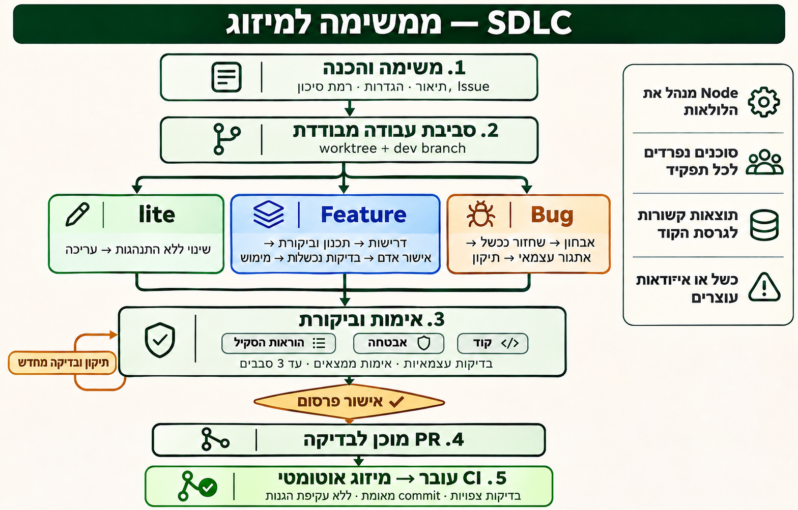

# SDLC — ממשימה ל־PR

סקיל לפרויקט ב־`.agents/skills/sdlc`, עם פלאגין מלא ב־`.claude/skills/sdlc`.
ב־Codex מפעילים `$sdlc`; ב־Claude Code מפעילים `/sdlc` או `/sdlc:sdlc` לפי
אופן טעינת הפלאגין. פקודות נוספות: `init`, `validate`, `cleanup`, `grilling`,
`plan-review`, `devils-advocate` תחת namespace של sdlc.



נדרשים Node 22 ומעלה, Git ו־gh מאומת. ה־host צריך לנהל תהליך Node עם pipes
ולהפעיל סוכנים נפרדים. ה־runner מנהל את הלולאות ותור הבקשות באמצעות NDJSON;
פרטי החיבור ב־[runtime](../.claude/skills/sdlc/references/runtime.md).
ה־Bash hook דורש גם Bash ו־jq ואינו מופעל אוטומטית ב־Codex.

לפני הריצה הראשונה: remote תקין, commit בסיס והגדרות בדיקה מאושרות דרך
`/sdlc:init`. אין להשתמש בבדיקות הפלאגין בתור כל בדיקות הפרויקט. התקנה מקומית
אינה יוצרת GitHub repository ואינה משנה את האתר.

בדיקת הפלאגין ללא התקנת חבילות npm:

```sh
npm --prefix .claude/skills/sdlc run verify
```

טעינה מפורשת ב־Claude:

```sh
claude --plugin-dir ./.claude/skills/sdlc
```

יש אישור אדם לתכנית פיצ׳ר ולאחר validation לפני פרסום. bug מחייב שחזור
נכשל ואתגור עצמאי לפני תיקון. אחרי יצירת PR, הסקיל ממזג אוטומטית כשבדיקות
ה־CI הצפויות עברו על ה־commit שנבדק וכל דרישות GitHub מולאו. אפשר לבטל
באמצעות `autoMerge:false`. אין אישור חוזר כאשר המשתמש כבר אישר פרסום ומיזוג.
שמות הבדיקות מוגדרים ב־`autoMergeChecks`; אין עקיפת הגנות ענף או `--admin`.
כשל, תוצאה חסרה, שינוי תוכן בזמן review או ממצא שלא הופרך אינם אישור.

[החלטות ארבעת הסוקרים](sdlc-review-2026-11-18.md) ·
[פרומפט התרשים, ImageGen מובנה](sdlc-image-prompt.txt)

הבדיקות האוטומטיות כוללות transport אמיתי עם סוכנים מדומים ו־Git זמני;
בדיקת ריצת מודלים מלאה מול GitHub נותרת שלב אינטגרציה נפרד.
